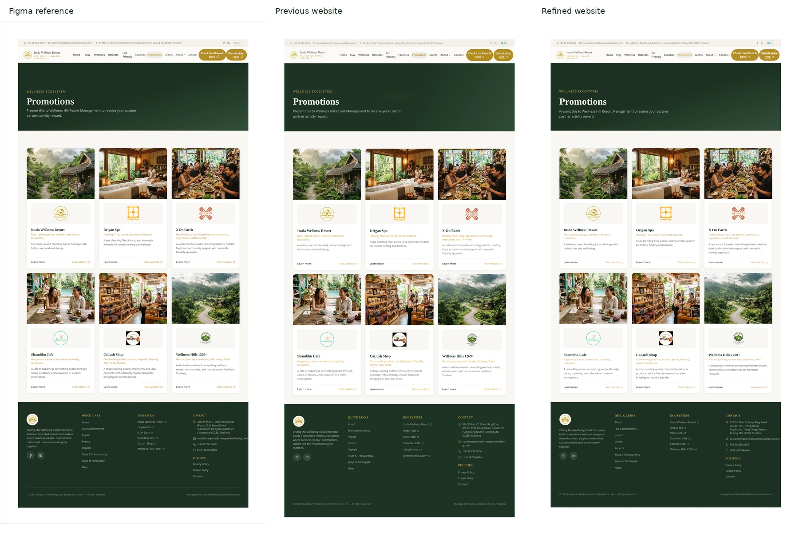

# Promotions refinement review — 13 October 2026

All five supplied reference images were inspected. They are at the repository root, including `promotions.png` (2960×5583, exported at 2×). No Figma MCP was used. The visual review and JSX improvements were performed with Sol at Extra High reasoning as requested.

## Preserved versions

- Previous website: `feat/wellness-promotions`, commit `a193391`.
- Refined website: `feat/wellness-promotions-refinement`, based on that commit.
- The previous branch and `main` remain unchanged. Only the refinement branch is updated.

The comparison is scaled for convenient review. It contains the real reference and browser screenshots. Browser rendering is editable React/CSS, not a full-page background image.

## Visual corrections

- Sampled the original surface colors: green `#1c3122`, contact bar `#f5f2ec`, navigation `#fcfbf8`, cream `#f8f6f2`, gold buttons `#b48e27`, and accent `#c59d59`.
- Corrected the 42px contact bar, 90px navigation, 376px banner, partner-card heights and spacing, and footer geometry. Revised the subtle banner gradient/ellipse.
- Replaced the absent local Georgia font fallback with self-hosted Tinos, measured against the serif glyphs in the screenshot. Tuned heading tracking, eyebrow weight, card line height, footer column gaps, ecosystem/quick-link spacing, and copyright contrast.
- Corrected the footer email layout so it fits on one desktop line in the original gutter. Kept the address at four lines without widening other contact rows.
- Re-extracted all six photos at original coordinates. Re-extracted six partner logos and the footer logo as lossless WebP, preserving the supplied artwork. No stock images were introduced.
- Tablet layout uses two columns through 1100px; mobile uses one through 560px. Navigation wraps without overlapping or removing the menu labels.

At 1480px viewport width with a 2× browser screenshot:

| Measurement (CSS pixels) | Figma reference | Previous website | Refined website |
| --- | ---: | ---: | ---: |
| Navigation height | 90 | 91.19 | 90 |
| Banner height | 376 | 378.83 | 376 |
| Footer top | 2115.5 | 2126.72 | 2114.98 |
| Footer height | 586.5 | 628.78 | 586 |
| Page height excluding outer white padding | about 2602 | 2655.5 | 2600.98 |

The heading's filled glyph width is approximately 260.5px versus 261px in the reference. Minor serif shape, antialiasing, and gradient differences remain because original font metadata and standalone assets were not provided. These measurements establish close geometry rather than claiming a pixel-perfect match.

## Functionality, accessibility, and code

- Retained the single page at `/`, Promotions active state, all six partner names/taglines/descriptions, business information, and existing button/link labels.
- The supplied Google Form URL opens in a new tab using `target="_blank"` and `rel="noopener noreferrer"`. Its accessible name announces the new tab. Tests verify the exact full popup URL and null `window.opener`, using an intercepted destination without contacting/submitting Google's form.
- All 43 unspecified destinations are genuinely disabled and omitted from the keyboard tab order. No invented routes or business information.
- Added a focusable main target for the skip link, explicit image dimensions, stronger focus outlines, and native disabled semantics; removed setup-detail tooltips.
- Formatted JSX/CSS into readable components and data without adding extra abstraction or runtime libraries.
- All fonts and images are locally served. WOFF2-only font subsets avoid redundant WOFF assets. Explicit image dimensions and reserved aspect ratios reduce layout shifts; only the first photo is eager/high-priority and remaining photos are lazy.

## Performance evidence

| Six-photo payload | Bytes | Change versus previous photos |
| --- | ---: | ---: |
| Previous full-resolution WebP | 959,398 | — |
| Refined full-resolution WebP | 704,236 | −26.6% |
| Refined 400px variants | 253,814 | −73.5% |

Browsers choose the variant based on viewport and pixel density; the 400px figures do not imply every device downloads only small variants. Lossless logo files are slightly larger to preserve the reference artwork. Production JavaScript is about 72.4KB gzipped; no client-side Figma/image service is required.

## Validation

- `npm run build`: passed, static production output in ignored `dist/`.
- Browser smoke tests: passed on development and production preview servers at 1480, 1280, 1200, 1101, 1100, 1024, 768, 561, 560, 390, and 320px. Includes actual keyboard/mouse activation, exact content, image decoding, reserved dimensions, overflow/overlap, inactive controls, and browser/resource errors. No unexpected browser or resource errors observed in stable final runs. The test accepts a cancelled responsive image candidate only after verifying its declared replacement returned HTTP 200 and decoded; all other failed requests still fail the test. See [responsive image validation](responsive-image-validation.json).
- Observed layout-shift scores were below 0.002 on these local runs. These are local measurements, not a claim about production field Core Web Vitals.
- Axe-core 4.14 audit at 1480, 1024, 390, and 320px: 37 rules passed, with zero violations in `prefers-contrast: more` mode. Default reference colors retain 12 low-contrast nodes. See [audit evidence](accessibility-audit.json). Hero text against a gradient required a manual contrast check; its high-contrast values pass against the brightest gradient stop.
- `git diff --check`: passed.

The default reference palette is not fully WCAG AA compliant. Stronger contrast is provided when the user's system requests it; a fully AA default would require changing the original gold palette. This limit is stated rather than hiding failed audit findings.

## Remaining inputs and deployment

Original vector/image files and exact Figma font metadata remain unavailable. All non-Promotions/non-form destinations remain inactive until verified URLs are supplied. These limits are unchanged in scope.

No deployment was performed and Hostinger was not accessed or modified. Build and Nginx deployment instructions remain in [README](../README.md). Publish only the contents of `dist/` when you choose to deploy.
